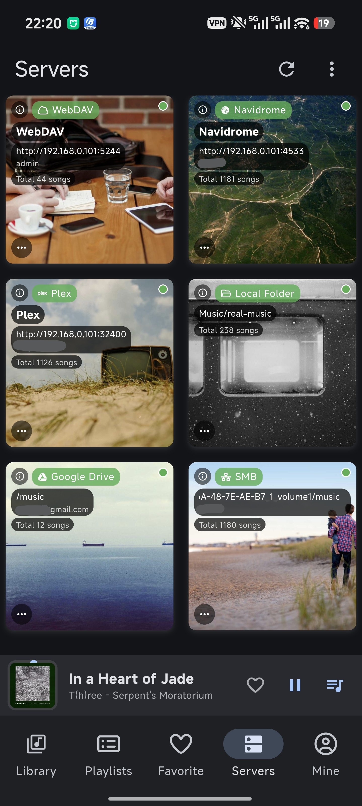
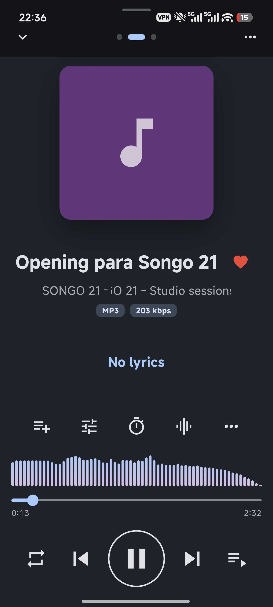
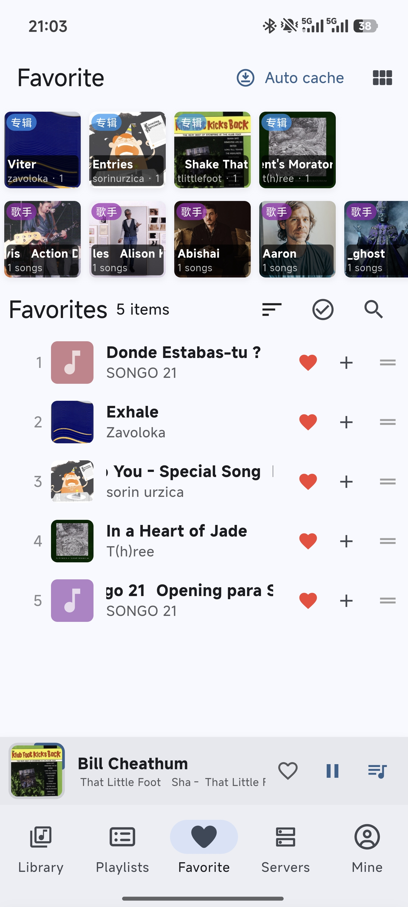

# Foxmomo Music

**Bring your scattered cloud music together.**

**Foxmomo Music** is a cross-platform music player that unifies your self-hosted music servers, cloud drives, and LAN shares into a single library — browse, search, stream, and cache your entire music collection from one app.

## Download

| Platform | Link |
| --- | --- |
| **Windows** (portable, x64) | [GitHub Releases](https://github.com/an-ttt/FoxmomoMusic/releases) — download the zip, extract, and run `Foxmomo-Music.exe` |
| **Android** | [Google Play](https://play.google.com/store/apps/details?id=com.foxmomo.music) |
| Website | [foxmomo.com](https://foxmomo.com/) |

> **Windows first launch**: the app is not code-signed yet. If SmartScreen shows "Windows protected your PC", click **More info → Run anyway**.

## Screenshots

| Servers | Player | Favorites |
| :---: | :---: | :---: |
|  |  |  |

## Key Features

- 🎧 **Self-hosted servers** — Subsonic, Navidrome, Emby, Jellyfin, Koel, Plex, gonic
- ☁️ **Cloud drives** — Google Drive, OneDrive, Dropbox
- 🗂️ **LAN sharing** — SMB / WebDAV
- 🎼 Lyrics display, audio effects, offline caching
- 🔍 Unified library with search, playlists, and favorites
- 💜 One-time purchase, lifetime access

## Copyright

Copyright © 2026 an-ttt. All rights reserved.

---

# Foxmomo Music

**让分散在云端的音乐，在此集结。**

**Foxmomo Music** 是一款跨平台音乐播放器，将你的自建音乐服务器、云盘与局域网共享整合到同一个曲库——在一个应用里浏览、搜索、串流并缓存你的全部音乐。

## 下载

| 平台 | 链接 |
| --- | --- |
| **Windows**（免安装，x64） | [GitHub Releases](https://github.com/an-ttt/FoxmomoMusic/releases) — 下载 zip，解压后运行 `Foxmomo-Music.exe` |
| **Android** | [Google Play](https://play.google.com/store/apps/details?id=com.foxmomo.music) |
| 官网 | [foxmomo.com](https://foxmomo.com/) |

> **Windows 首次运行**：应用暂未做代码签名，如弹出 SmartScreen「Windows 已保护你的电脑」，请点击 **更多信息 → 仍要运行**。

## 主要功能

- 🎧 **自建音乐服务器** — Subsonic、Navidrome、Emby、Jellyfin、Koel、Plex、gonic
- ☁️ **云盘直连** — Google Drive、OneDrive、Dropbox
- 🗂️ **局域网共享** — SMB / WebDAV
- 🎼 歌词显示、音频效果器、离线缓存
- 🔍 统一曲库，支持搜索、歌单与收藏
- 💜 一次购买，终身使用

## 版权

Copyright © 2026 an-ttt. All rights reserved.（版权所有，保留所有权利）
